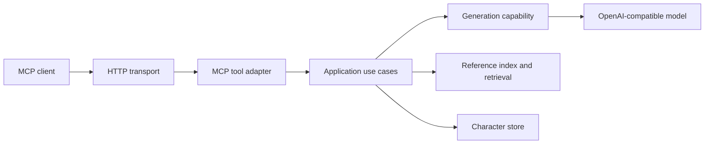

# Architecture

## Boundaries

- The HTTP server is a transport and configuration adapter.
- MCP tool registration is isolated in `lib/mcp-tools.mjs`.
- Application use cases are exposed through `createCharacterApplication` in `lib/application.mjs`.
- Generation schemas, model calls, shared generation policy, and character renderers are composed through `lib/character-generation.mjs`.
- Manifest loading, file discovery, format inference, and normalized reference descriptors are shared through `lib/reference-index.mjs`.
- Filesystem persistence and reference retrieval use `lib/file-store.mjs` for containment and atomic-write primitives.
- Filesystem remains the concrete storage adapter until a second implementation justifies a generic interface.

## Request flow

## Stable invariants

- Preserve existing MCP tool names and payload intent.
- Keep generation and rendering behind the application seam; keep model and schema details out of the HTTP adapter.
- Do not claim storage is durable unless the selected storage adapter confirms the write.
- Reject path traversal and unsafe record identifiers before filesystem access.
- Do not introduce a generic adapter interface for a single concrete implementation.
- Treat the reference index as the shared source of reference identity and eligibility.
- Treat denied destructive Git commands as requiring a reversible alternative or explicit human intervention.
